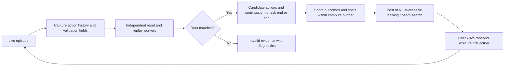

# Safety-CHORES-RL

Simulator tooling, isolated replay rollouts, and budgeted search for Safety-CHORES.

This is a local release draft. The simulator uses external Safety-CHORES tasks and
assets. Generic planners and synthetic examples run with Python alone. Native
plan/execute/replan has passed a bounded test on an existing installation;
native task-success and portable simulator installation remain release gates.

## Try the portable examples

```sh
python -m pip install -e ".[test]"
python -m pytest -q
python examples/fast_search.py --workers 2
python examples/benchmark_search.py --workers 2
```

See [API semantics](docs/api.md) for the runtime and search contracts.

## How planning works



Successive halving reduces sample allocation for weaker candidates. Exact
request caching reuses valid results; process workers isolate the live episode.
Every deeper beam prefix reconstructs the episode by replay. This has reset
overhead and does not provide a hidden physics-state clone.

## Measured portable examples

| Check | Result | Scope |
| --- | --- | --- |
| Exhaustive candidate evaluation | 64 rollouts | Synthetic known-winner problem |
| Successive halving | 20 rollouts; same winner | 68.75% fewer rollouts on that problem |
| Beam planning with live replanning | Goal reached in 6 actions; zero cost | Synthetic grid task |

These are reproducible API demonstrations, not native simulator performance or
benchmark task-success results. See [native validation](docs/native.md) for
the existing-installation probe and [release gates](docs/release.md) for what
remains before publication.
