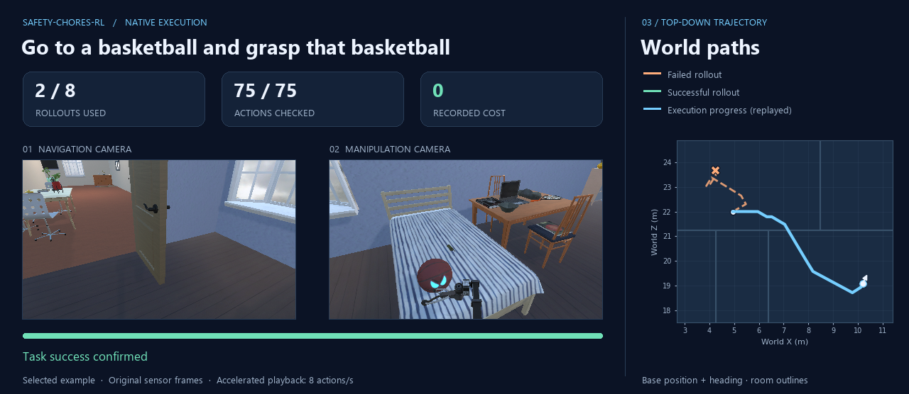

# Safety-CHORES-RL

Simulator tooling, isolated replay rollouts, and budgeted search for Safety-CHORES.

Research software accompanying **[A Safe Action Is Not Enough: Feasible-Future
Decoding for Vision-Language-Action Policies](https://arxiv.org/abs/2610.05166)**,
by **Tu Nguyen, Matthieu Zimmer, Vu Anh Vu, Ziyi Wang, Jannik Hammel Nielsen,
Xuebing Zhou, and Haitham Bou Ammar**. [BibTeX](CITATION.bib).

This repository provides native rollout and search tooling. The paper's VICS-G
decoder requires no online rollouts; it studies rollout augmentation separately.
The demonstrations here validate the tooling on selected native episodes.

**[Explore the project website →](https://tumeteor.github.io/safety-chores-rl/)**

The website brings together native camera recordings, animated trajectories,
reset → replay → branch comparisons, and an interactive trajectory explorer.



## A practical native example

`FirstSuccess` finds a completed zero-cost continuation, retains the whole path,
and checks every executed transition. The selected native example used **2 of 8
allowed rollouts**, then completed **75 checked actions with zero recorded cost**.
Search took 180.3 seconds on one H100; the complete run took 339.8 seconds.

These are selected example results, not a success-rate estimate or a general
safety guarantee. The [website](https://tumeteor.github.io/safety-chores-rl/#explorer)
also shows unsuccessful and costly branches from separate recorded episodes.
See the [result receipt](docs/assets/first-success.json),
[native reproduction guide](docs/native.md), and [release assessment](docs/release.md).

## Try the portable examples

```sh
python -m pip install -e ".[test]"
python -m pytest -q
python examples/fast_search.py --workers 2
python examples/benchmark_search.py --workers 2
```

The portable examples demonstrate the API without a native simulator.
`BestOfN`, `SuccessiveHalving`, `BeamSearch`, and `RecedingHorizon` are also
available. Workers reconstruct branches by reset and action replay; the API
does not provide a hidden physics-state clone. See [API semantics](docs/api.md).

Native experiments require an external simulator player, tasks/assets, compatible
SafeVLA environment, and checkpoint. The selected 75-action result reproduced in
an isolated Python environment on Apex with all 45 tests passing; the
[environment receipt](docs/assets/apex-fresh-environment.json) also records six
dependency-version conflicts. Native validation is scoped to that tested configuration.

## Relation to LIBERO and Safety-CHORES

[LIBERO](https://github.com/Lifelong-Robot-Learning/LIBERO) focuses on manipulation
and knowledge transfer. [Safety-CHORES](https://safevla.github.io/) supplies
safety-critical navigation and mobile manipulation tasks. Safety-CHORES-RL builds
on Safety-CHORES with isolated reset-and-replay workers, budgeted search, and
checked trajectory execution. See the website's
[comparison of scope and interfaces](https://tumeteor.github.io/safety-chores-rl/#comparison).

## Documentation

- [Native setup, reproduction, and visualization](docs/native.md)
- [API and execution contract](docs/api.md)
- [Validation and limitations](docs/release.md)
- [Website build and deployment](docs/website.md)
- [Third-party notices](THIRD_PARTY_NOTICES.md)
