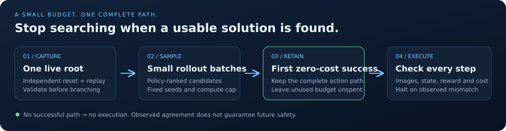
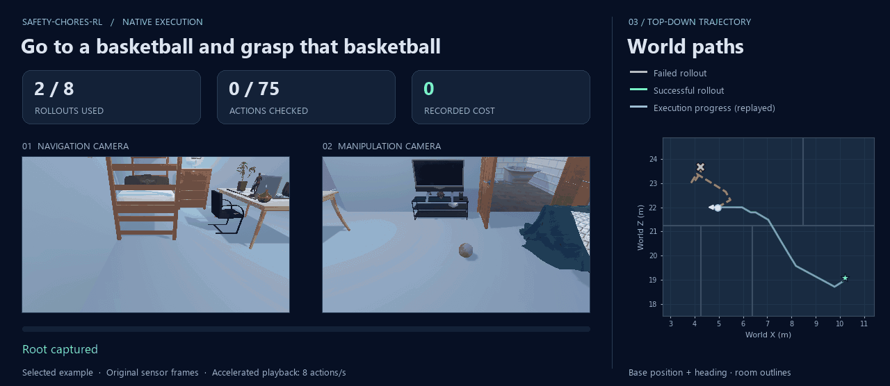

# Safety-CHORES-RL

Simulator tooling, isolated replay rollouts, and budgeted search for Safety-CHORES.

**Find a successful continuation, keep the whole path, and check every executed
step.** The native example below completes a Fetch task using two search rollouts
and an external SafeVLA policy on an existing simulator installation.



## A practical native example

Task: **go to a basketball and grasp that basketball**.



Original simulator observations, shown at 8 actions/second with a pause at the
end. Playback is accelerated; the timing below includes the actual work.

| Measured on 2026-10-09 | Result |
| --- | --- |
| Live task outcome | Success, **zero recorded cost** |
| Search continuations | **2 of 8 allowed**; first failed, second succeeded |
| Executed trajectory | **75 actions**, all 75 state/transition checks matched |
| Search time | 180.3 s, including worker reset/replay |
| Candidate preview / live execution | 48.3 s / 61.3 s |
| Complete run | 339.8 s, including live startup and cleanup |
| Hardware | One shared NVIDIA H100 80 GB; one rollout worker |

This is a **selected development example**, not a held-out benchmark or a
success-rate estimate. Task row 0, episode seed 1909, 200-action cap, two
policy-ranked candidate actions, and continuation seeds 4100–4103. Earlier
experiments informed this choice. The preview is an additional disposable
worker call, separate from the two search continuations. Six allowed
continuations were left unused; they were not measured in this run.
The [result receipt](docs/assets/first-success.json) retains both evaluated
outcomes, the action sequence, state hashes, timings, and source identities.

### Why this method is inexpensive

`FirstSuccess` tries candidates in caller priority order and evaluates seeds in
small worker batches. It stops after the first batch containing a completed
zero-cost trajectory, saving that trajectory as `plan.witness`. Execution uses
the saved actions and compares cameras, exposed physics, cost bookkeeping,
policy memory, rewards, and termination at every step. A mismatch raises before
the next action; without a successful witness, no trajectory is executed.

This avoids spending the full sample budget after a usable solution is found.
It needs neither a value model nor an exhaustive action tree. It offers no
optimality guarantee, and observed zero cost is not a guarantee of future safety.
See [the execution contract](docs/api.md#first-success-and-checked-execution).

In a [prepared native environment](docs/native.md):

```sh
PYTHONHASHSEED=0 CUBLAS_WORKSPACE_CONFIG=:4096:8 xvfb-run -a \
  python examples/native_first_success.py \
  --config runs/native.json --policy-config runs/policy.json \
  --out runs/first-success --task-id 0 --seed 1909 \
  --episode-limit 200 --workers 1 --vulkan-device 0 \
  --candidates 2 --sample-seeds 4100 4101 4102 4103 --save-frames
```

The simulator, tasks/assets, compatible SafeVLA environment, and checkpoint are
external dependencies. This remains a local release draft; portable native
installation, broader validation, and redistribution review remain
[release work](docs/release.md).

## Try the portable examples

```sh
python -m pip install -e ".[test]"
python -m pytest -q
python examples/fast_search.py --workers 2
python examples/benchmark_search.py --workers 2
```

| Portable demonstration | Result |
| --- | --- |
| Synthetic known-winner problem | Successive halving uses 20 rollouts versus 64 exhaustive evaluations; same winner |
| Synthetic grid task | Beam planning with live replanning reaches the goal in 6 actions, zero cost |

These demonstrate the API, not native benchmark performance. `BestOfN`,
`SuccessiveHalving`, `BeamSearch`, and `RecedingHorizon` remain available for
other search objectives. Workers reconstruct each branch by reset and action
replay; the API does not provide a hidden physics-state clone. Exact request
caching reuses valid results within a session. See [API semantics](docs/api.md).
